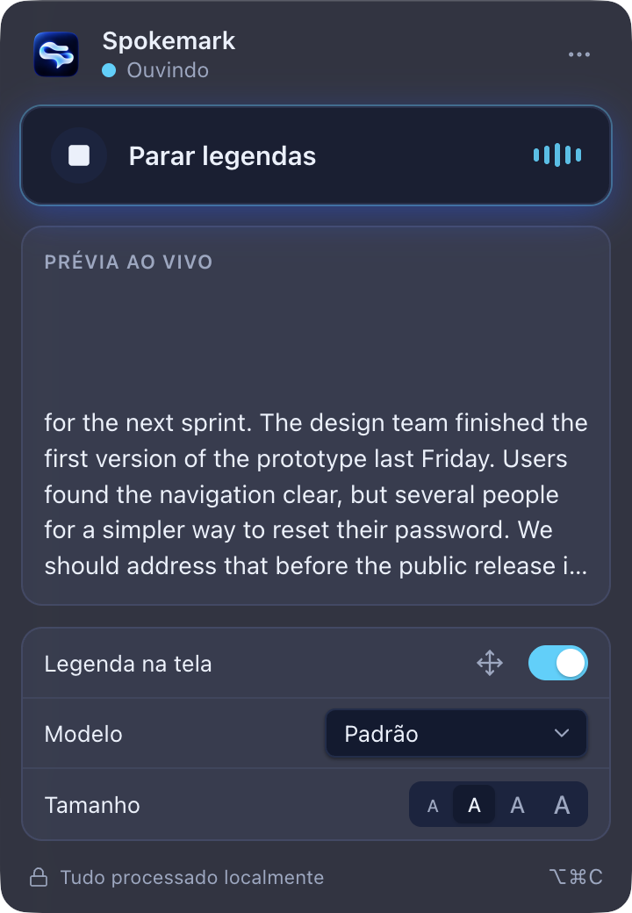
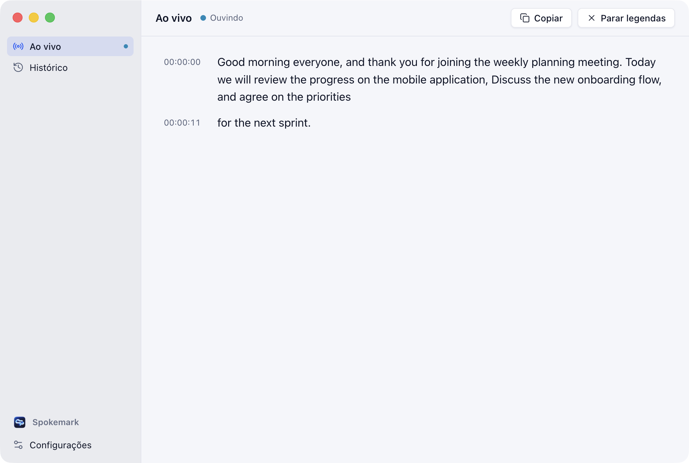
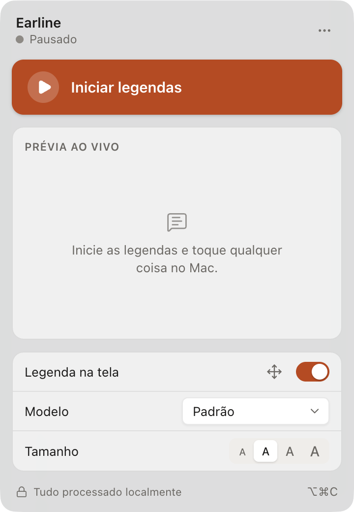
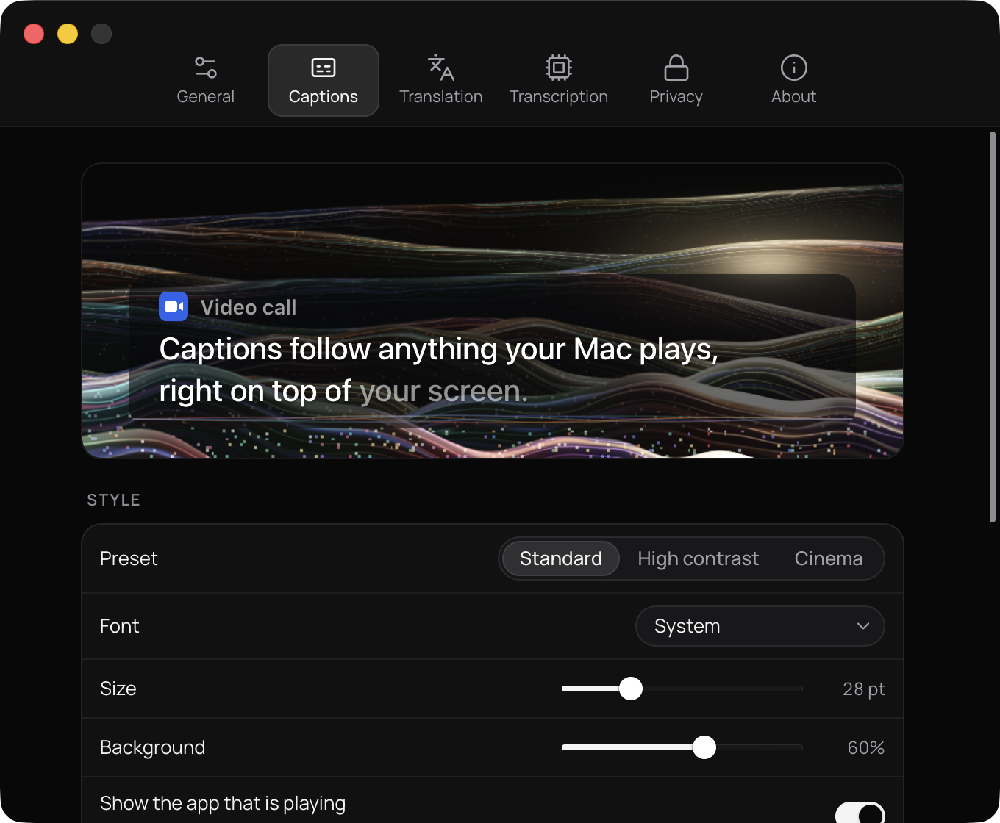
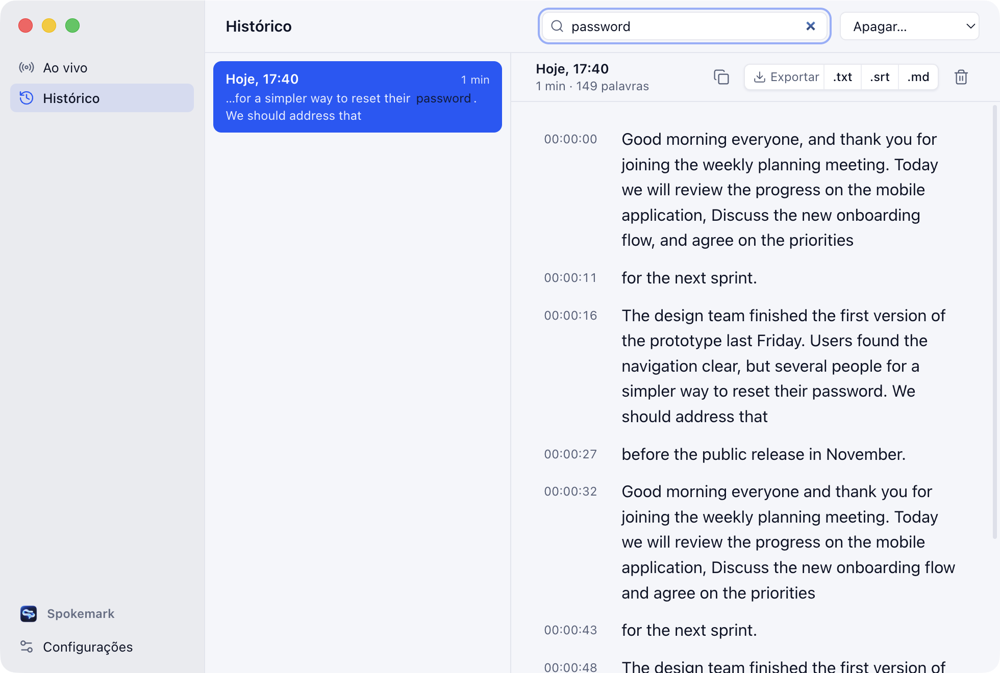

<div align="center">


# Spokemark

**Real-time captions and transcripts for anything your Mac plays.**<br>
Calls, videos, podcasts — 100% on-device. No cloud, no account, no audio ever leaves your Mac.

[](https://github.com/VitoorFranca/spokemark/actions/workflows/ci.yml)
[](LICENSE)


[Download](https://github.com/VitoorFranca/spokemark/releases) ·
[Features](#features) ·
[How it works](#how-it-works) ·
[Build from source](#build-from-source) ·
[Contributing](CONTRIBUTING.md)


&nbsp;


</div>

## Features

- **Captions over everything.** A clean, always-on-top caption overlay that stays above full-screen apps and on every Space. Click-through by default; drag and resize it in edit mode.
- **Works with any app.** Meet, Zoom, Teams, Discord, YouTube, podcasts — Spokemark listens to the Mac's sound output with a CoreAudio Process Tap. No virtual audio driver, no changing your output device, playback stays audible.
- **Private by design.** Speech recognition runs locally with [whisper.cpp](https://github.com/ggml-org/whisper.cpp) on the GPU (Metal). Audio is never recorded or saved; nothing is sent to the internet. Models are downloaded once and verified by SHA-256.
- **Live transcript and searchable history.** Read the full session in a large window with timestamps, then search every past session (SQLite full-text search) and export to `.txt`, `.srt` or `.md`. History is text-only, can be turned off, and expires after 30 days by default.
- **Menu bar first.** Start and stop with one click or a global shortcut, see what's being captured, and fix problems (permission, missing model) right from the panel.
- **Made for reading.** Caption presets (Standard, High contrast, Cinema), font, size, background opacity, 2–3 lines, top or bottom, per-display position — with a live preview.
- **Speaker changes (experimental).** The *Enhanced · speakers* model starts a new line when a different person starts talking.
- **Native feel.** Light and dark mode, vibrancy, full keyboard navigation, VoiceOver labels, English and Brazilian Portuguese.

> [!NOTE]
> The included models recognize **English** speech. The interface is available in English and Portuguese (Brazil).

## Screenshots

| Menu bar panel | Settings — Captions | History |
|---|---|---|
|  |  |  |

More (every surface, light and dark, including empty, loading and error states) in [`docs/screenshots`](docs/screenshots).

## Requirements

- A Mac with **Apple Silicon** (M1 or later)
- **macOS 14.2** or later (CoreAudio Process Taps)
- ~150 MB of disk for the default speech model (downloaded on first launch)

## Install

1. Download the latest `Spokemark-<version>-macos-arm64.dmg` from [Releases](https://github.com/VitoorFranca/spokemark/releases) and drag **Spokemark** to **Applications**.
2. Builds are **not notarized** (the project has no Apple Developer ID). The first time, **right-click Spokemark → Open**, or allow it in **System Settings → Privacy & Security**.
3. Follow the onboarding: grant **System Audio Recording** permission, download the speech model, and try it with any video.

Verify a download with `shasum -a 256 -c SHA256SUMS.txt` (published with every release).

### Permissions

Spokemark needs only **System Audio Recording** (System Settings → Privacy & Security → Screen & System Audio Recording → *System Audio Recording Only*). Microphone and screen recording are **not** used.

## Usage

| Action | Default shortcut |
|---|---|
| Start / stop captions | <kbd>⌥</kbd> <kbd>⌘</kbd> <kbd>C</kbd> |
| Show / hide captions | <kbd>⌥</kbd> <kbd>⌘</kbd> <kbd>O</kbd> |
| Move captions (edit mode, <kbd>Esc</kbd> to finish) | <kbd>⌥</kbd> <kbd>⌘</kbd> <kbd>E</kbd> |
| Settings | <kbd>⌘</kbd> <kbd>,</kbd> |
| Search history | <kbd>⌘</kbd> <kbd>F</kbd> |

Shortcuts are configurable in **Settings → General**.

## How it works

```
audiotap (Swift, CoreAudio Process Tap) ──PCM frames──▶ main process (Electron)
                                                        ├─ resample to 16 kHz mono, fixed ring buffer
                                                        ├─ Silero VAD ─┐
                                                        ├─ sliding windows ──▶ whisper-worker (C++, whisper.cpp + Metal)
                                                        ├─ LocalAgreement-2: confirmed text vs. provisional tail
                                                        ├─ overlay · panel · main window · settings (typed IPC)
                                                        └─ history (SQLite FTS5, text only)
```

- **Capture** — a small Swift helper creates a global, unmuted Process Tap and streams framed PCM to the main process. Audio never touches a renderer.
- **Recognition** — a C++ helper keeps the Whisper model loaded on the GPU. Silero VAD gates every window: no speech, no inference, no hallucinated text during silence.
- **Streaming** — Whisper isn't a token-streaming model; Spokemark re-transcribes a sliding window every 500 ms and only commits words two consecutive hypotheses agree on (LocalAgreement-2). Confirmed text never changes; only the provisional tail does.
- **Isolation** — both helpers are separate processes, restarted with backoff if they crash, and they exit on their own if the app dies.

Design decisions and the alternatives we discarded are documented in [`docs/DECISIONS.md`](docs/DECISIONS.md) and [`docs/DESIGN.md`](docs/DESIGN.md).

### Performance

Measured on a MacBook Air M4 (16 GB) with real system audio; full methodology and numbers in [`docs/RESULTS.md`](docs/RESULTS.md).

| | Default model (`base.en`) | Enhanced (`small.en`) |
|---|---|---|
| Speech → caption on screen (p50 / p95) | ~0.45 s / ~1.3 s | ~0.6 s / ~1.5 s |
| Word error rate | 2.3 % (30-min session, 2,750 words) | 3.8 % (550 words) |
| Words produced in long silences | 0 (621 s) | 0 (124 s) |
| Memory while capturing (app + overlay + speech engine) | ~640 MB, stable | ~1.0 GB, stable |
| CPU time (all processes, ~6-min session) | 58 s (≈ 15 % of one core on average) | — |

## Build from source

```bash
git clone https://github.com/VitoorFranca/spokemark.git && cd spokemark
brew install cmake          # to build whisper.cpp
npm install
npm run build:native        # audiotap (Swift) + whisper-worker (whisper.cpp v1.9.5, Metal)
npm run models              # base.en + Silero VAD → ~/Library/Application Support/Spokemark/models
npm run dev                 # run in development
npm run package             # release/Spokemark-darwin-arm64/Spokemark.app (ad-hoc signed)
```

In development the audio permission belongs to your **terminal app**. If your terminal doesn't show a prompt, add it manually under *System Audio Recording Only*.

### Tests

```bash
npm run typecheck
npm test                    # unit tests (vitest)
npm run test:ui             # end-to-end UI tests (Playwright for Electron)
E2E_AUDIO=1 npx playwright test   # also runs the test that plays audio through the speakers
```

The audio pipeline also has end-to-end harnesses that play reference speech through the real system output (`scripts/e2e-*.sh`); see [`docs/RESULTS.md`](docs/RESULTS.md).

### Releases

Push a tag such as `v0.2.0` and [the release workflow](.github/workflows/release.yml) builds a portable binary, runs the tests, and publishes `Spokemark-<version>-macos-arm64.dmg`, `.zip` and `SHA256SUMS.txt`. *Run workflow* on the same workflow builds the artifacts without publishing. Builds are ad-hoc signed; the workflow can also sign with a Developer ID and notarize if `APPLE_*` secrets are configured (see the workflow file).

## Project layout

```
native/audiotap/          Swift system-audio capture helper (Process Tap)
native/whisper-worker/    C++ speech engine helper (whisper.cpp + Metal + Silero VAD)
src/main/                 Electron main process: pipeline, history, windows, menus
src/preload/              minimal, validated bridges for the sandboxed renderers
src/renderer/             React UI: overlay, panel, main window, settings, onboarding
src/shared/               typed IPC (zod), i18n, settings, exporters
scripts/                  native build, models, packaging, release, e2e harnesses
docs/                     decisions, design, brand, measured results, screenshots
```

## Contributing

Bug reports, ideas and pull requests are welcome — please read [CONTRIBUTING.md](CONTRIBUTING.md) and our [Code of Conduct](CODE_OF_CONDUCT.md). Report security issues privately as described in [SECURITY.md](SECURITY.md).

## License

The source code is released under the [MIT License](LICENSE).

The **Spokemark name, logo and visual identity are not covered by the MIT License.** You may use the logo to identify, reference or promote the project, but not to present a fork or derivative as official. See [TRADEMARKS.md](TRADEMARKS.md).

## Acknowledgements

- [whisper.cpp](https://github.com/ggml-org/whisper.cpp) and the [OpenAI Whisper](https://github.com/openai/whisper) models (MIT)
- [Silero VAD](https://github.com/snakers4/silero-vad) (MIT) and [tinydiarize](https://github.com/akashmjn/tinydiarize) (MIT)
- [Electron](https://www.electronjs.org), [React](https://react.dev) (MIT) and [Lucide](https://lucide.dev) icons (ISC)
- The *LocalAgreement* streaming policy from Macháček et al., *Turning Whisper into Real-Time Transcription System* (2023)
