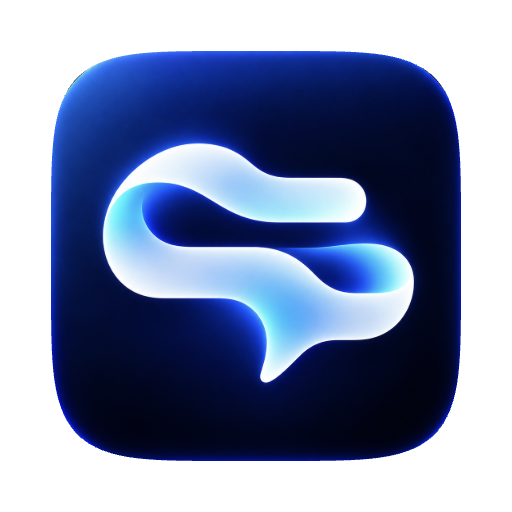
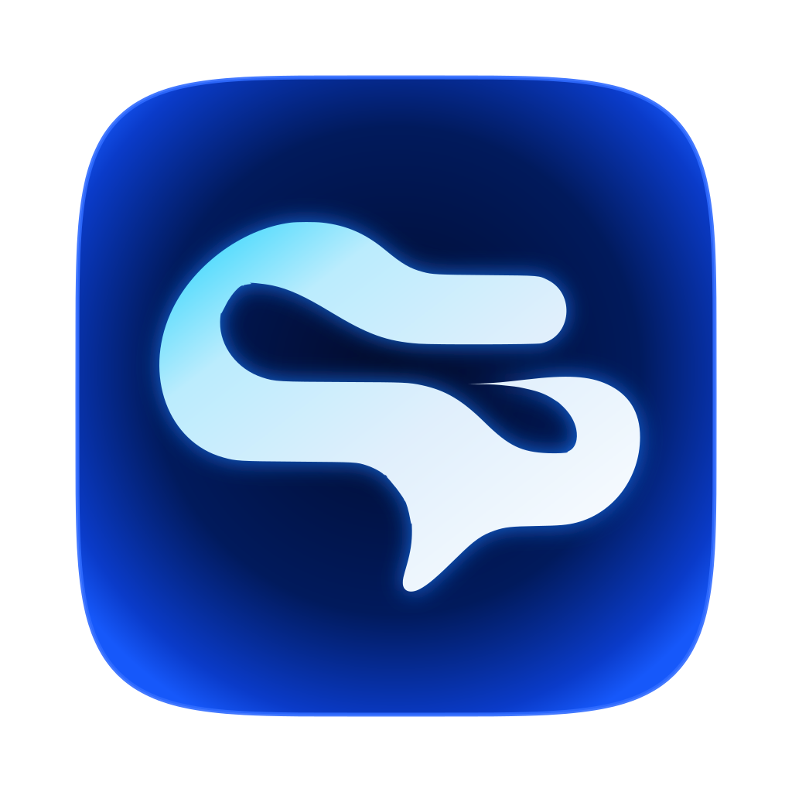

# Brand — Spokemark

> The Spokemark name, logo and visual identity are **not** covered by the MIT License. See [`TRADEMARKS.md`](../TRADEMARKS.md).

&nbsp;

## Name: **Spokemark**

*spoken* + *mark* — the mark of what was said. Deliberately broad: it fits today's live captions and the planned expansion (meeting transcription, history, minutes) as well as a possible community edition.

**Domains on 2026-10-11**, checked through RDAP (the registries' official source; `404` means unregistered):
- `spokemark.com` (Verisign) and `spokemark.app` (Google Registry) were both **unregistered**.
- "Unregistered" does not guarantee a regular price — a name can be reserved or *premium*; confirm with a registrar before buying.
- No app or product with this name was found in a web search. No trademark search (INPI/USPTO) was made.

**How the name was chosen:**
1. The first proposal, **Earline**, had a free `.app` but a registered `.com`, so it was dropped.
2. ~130 candidates were then checked requiring **both** `.com` and `.app` free; almost every name built from common words already has its `.com` registered.
3. Eight passed: Saidstone, Minuteloom, Wrenote, **Spokemark**, Quillear, Heardlight, Heardara, Larkscribe. Larkscribe had a mention of an audio app with the same name; Minuteloom is close to the Loom brand.

**In code:** a single constant, `APP_NAME` in `src/shared/brand.ts`, drives the package name, UI text, data folder and menus.
- **Bundle ID:** still the MVP's, to keep the TCC permission users already granted.
- **Data folder:** folders from earlier builds ("Earline", "Live Captions") are migrated once.

## Logo

**Source:** `assets/logo.png` (1254 px), generated with AI (ChatGPT), without a hired designer and without intentional use of third-party elements. A speech-bubble "S" in white, ice and cyan with a glow, on an electric-blue squircle over navy.

### Derived assets

| File | How it is made | Used for |
|---|---|---|
| `build/macos/icon.icns` (128–1024 px) | the **original PNG**, clipped with a continuous-corner squircle (superellipse n=5) on the macOS 824/1024 grid | app icon |
| `build/macos/icon.icns` (16, 32 px) | `logo.svg` | at small sizes the original's glow turns to blur; the vector stays crisp |
| `src/renderer/public/icon.png`, `assets/brand/icon-512.png` | the original PNG, clipped, 512 px | logo inside the app (panel, onboarding, About, sidebar) and in the docs |
| `assets/brand/glyph.svg` | the glyph vectorized with `potrace` from the PNG (bright pixels: green > 140, inside the squircle) | base of the vectors below |
| `assets/brand/logo.svg` | a vector **recreation** with approximate gradients and glow — not an exact copy | small sizes, web, docs |
| `assets/tray/*Template.png` | `tray-idle.svg` (solid glyph) and `tray-listening.svg` (glyph + indicator dot), 18 pt @1x/@2x | menu bar (monochrome template images) |

**Regenerate:** `scripts/brand/vectorize-logo.sh`, then `npx electron scripts/render-icons.cjs`. The pipeline is reproducible: its output is byte-identical to the committed files.

## Colors (from the logo)

Sampled from the logo's pixels: navy `#00061E` / `#012478`, electric blue `#1658FA` / `#0034BE`, cyan `#18D2FD`, ice `#BBECFD`.

| Token | Light | Dark | Use |
|---|---|---|---|
| `--bg` | `#F5F6FA` (cool neutral) | `#0A0F1F` (navy) | window background |
| `--surface` / `--surface-2` | `#FFFFFF` / `#ECEEF5` | `#121A30` / `#1A2440` | cards, inset areas |
| `--text` | `#0D1326` (17:1) | `#EAF0FB` (16.7:1) | primary text |
| `--text-2` | `#566079` (5.8:1) | `#9AA7C2` (7.9:1) | secondary text |
| `--accent` | `#1658FA` electric blue (white text 5.5:1) | `#18D2FD` cyan (10.6:1; navy text on it 10.3:1) | primary action, selection, focus |
| `--signal` | `#0789B8` (3.7:1, graphic) | `#18D2FD` | "listening" state, level meter |
| `--success` / `--warning` / `--danger` | `#0F7A50` / `#9A5A00` / `#C42B1F` | `#3FD49A` / `#F2B84B` / `#FF7A6E` | states (all ≥ 4.5:1 on surfaces) |
| `--chrome-tint` | ice at 35% | navy at 55% | tints the system vibrancy toward the brand (panel, sidebar, toolbar) |
| `--glow` | blue shadow | cyan outline + blue shadow | **static** glow on the main button while listening, echoing the logo |

- Contrast computed with the WCAG 2.x formula; tokens live in `src/renderer/shared/tokens.css`.
- Radii 6 / 10 / 14 px; transitions 180 ms.
- The **overlay does not use brand colors**: white on black for legibility.
- Blue is macOS's default accent; the identity stands apart through cyan (active state) and navy (dark theme).

## Typography

- **UI:** the system font (`-apple-system`, i.e. SF Pro).
- **Captions:** System (SF Pro), Rounded (SF Pro Rounded), Serif (New York) or Monospaced (SF Mono). Default: System, medium weight — highly legible at large sizes.

## UI icons

**Lucide** (`lucide-react`), 1.75 px stroke at 16–18 px, imported per icon (tree-shaken). SF Symbols are not embedded.
